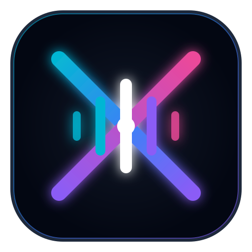

<div align="center">



# XonAudio Studio
### The Next-Gen Local AI Audio Workstation
**Zero-Shot Voice Cloning (F5-TTS) & High-Resolution Foley FX (Stable Audio Open)**

<p align="center">
  <a href="https://xonarous.nl" target="_blank">
    
  </a>
  <a href="https://github.com/Xonarouss/xonaudiostudio/releases" target="_blank">
    
  </a>
  <a href="https://buymeacoffee.com" target="_blank">
    
  </a>
</p>

<p align="center">
  
  
  
  
  
</p>

</div>

---

## ⚡ What is XonAudio Studio?

**XonAudio Studio** is a turn-key, local open-source AI audio production suite crafted by **[Xonarous Inc](https://xonarous.nl)**. It brings together state-of-the-art **Zero-Shot Voice Cloning** and **Generative Sound Effects / Foley Diffusion** in a clean, ultra-modern White Mode desktop web interface with live hardware monitoring.

```
┌────────────────────────────────────────────────────────────────────────┐
│                        XONAUDIO STUDIO ENGINE                          │
├───────────────────────────────────┬────────────────────────────────────┤
│           VOICE LAB               │           SOUND STUDIO             │
│        (F5-TTS v1 Base)           │     (Stable Audio Open 1.0)        │
│  • 5-10s Zero-Shot Voice Cloning  │  • 44.1kHz Stereo Foley Diffusion  │
│  • Flow-Matching Diffusion ODE    │  • 1s to 47s Duration Control      │
│  • Multilingual Speech Synthesis  │  • Cinematic Prompts & Seeds       │
├───────────────────────────────────┴────────────────────────────────────┤
│                DYNAMIC HARDWARE & STORAGE CONTROLLER                   │
│  • Live GPU % / Temp / GDDR7 VRAM / Power Draw / RAM / CPU Monitor    │
│  • Auto-detect & download new Hugging Face weights on startup         │
│  • 1-Click Disk Cleaner & VRAM Memory Purge                            │
└────────────────────────────────────────────────────────────────────────┘
```

---

## 🎯 Key Highlights

- 🤍 **Pure Light / White Mode UI:** Ultra-clean, eye-pleasing aesthetics with glassmorphic cards, crisp typography, and fluid micro-animations.
- 🚀 **1-Click Windows Launcher (`Start_AudioStudio.bat`):** Sets up your isolated `venv`, installs CUDA 12.4 dependencies, and launches both backend and web app automatically.
- 🖥️ **Desktop Shortcut Generator:** Prompts on launch to generate a branded Windows desktop shortcut with the official custom `.ico` logo.
- 🔄 **Automatic Model Upgrades:** Automatically queries Hugging Face commit hashes on launch; if a newer model revision or weights exist, it downloads the delta automatically!
- 📊 **Real-Time Dynamic Hardware Widget:** Live floating monitor matching production GPU monitoring tools:
  - GPU Utilization & Temperature (°C)
  - VRAM Consumption (e.g. `3.1 GB / 15.9 GB`)
  - Board Power Draw (e.g. `51 / 389 W`)
  - Total System RAM & CPU Utilization %
  - Audio Engine Footprint
- 📈 **Animated Progress Bars:** Clear percentage bars and stage descriptors during synthesis.

---

## 📦 Quickstart (Portable & 1-Click)

### Option 1: Download Pre-Packaged Release (Easiest)
1. Download `XonAudio-Studio-v1.0.0-Portable.zip` from [GitHub Releases](https://github.com/Xonarouss/xonaudiostudio/releases).
2. Extract the folder anywhere on your computer.
3. Double-click **`Start_AudioStudio.bat`**.

---

### Option 2: Clone with Git
```bash
git clone https://github.com/Xonarouss/xonaudiostudio.git
cd xonaudiostudio
```
Then double-click **`Start_AudioStudio.bat`** (Windows) or run `./start_audiostudio.sh` (Linux).

---

## 💻 System Requirements

| Component | Minimum | Recommended (Studio Pro) |
| :--- | :--- | :--- |
| **GPU** | NVIDIA GPU with 8 GB VRAM | NVIDIA RTX 4070 / 4080 / 5080 (12–16 GB VRAM) |
| **CPU** | 6-Core Intel / AMD Ryzen | AMD Ryzen 7 7800X3D or equivalent |
| **RAM** | 16 GB DDR4/DDR5 | 32 GB – 64 GB |
| **OS** | Windows 10/11 or Ubuntu 22.04+ | Windows 11 (64-bit) |
| **Python** | Python 3.10 or 3.11 | Python 3.11 with CUDA 12.4 |

---

## 🛠️ REST API Reference

| Endpoint | Method | Description |
| :--- | :--- | :--- |
| `/api/system/status` | `GET` | Live dynamic metrics (GPU %, Temp, VRAM, Power, RAM, CPU) |
| `/api/models/status` | `GET` | Status, paths, and size in GB of local checkpoints |
| `/api/models/download/{key}` | `POST` | On-demand download of `f5_tts` or `stable_audio` |
| `/api/models/delete` | `POST` | Purge checkpoints to reclaim storage space |
| `/api/models/unload` | `POST` | Release models from GPU VRAM |
| `/api/tts/generate` | `POST` | F5-TTS zero-shot voice cloning endpoint |
| `/api/sfx/generate` | `POST` | Stable Audio Open sound effect diffusion endpoint |

---

## 🍺 Support & Community

If you find XonAudio Studio helpful, consider supporting the development!

<p align="center">
  <a href="https://buymeacoffee.com" target="_blank">
    
  </a>
  <a href="https://xonarous.nl" target="_blank">
    
  </a>
</p>

---

## 📄 License & Credits

Distributed under the **MIT License**. See `LICENSE` for details.

- **F5-TTS:** Created by Yushen Chen et al. ([SWivid/F5-TTS](https://github.com/SWivid/F5-TTS)).
- **Stable Audio Open:** Released by Stability AI ([stabilityai/stable-audio-open-1.0](https://huggingface.co/stabilityai/stable-audio-open-1.0)).
- Proudly built by [**Xonarous Inc**](https://xonarous.nl).
